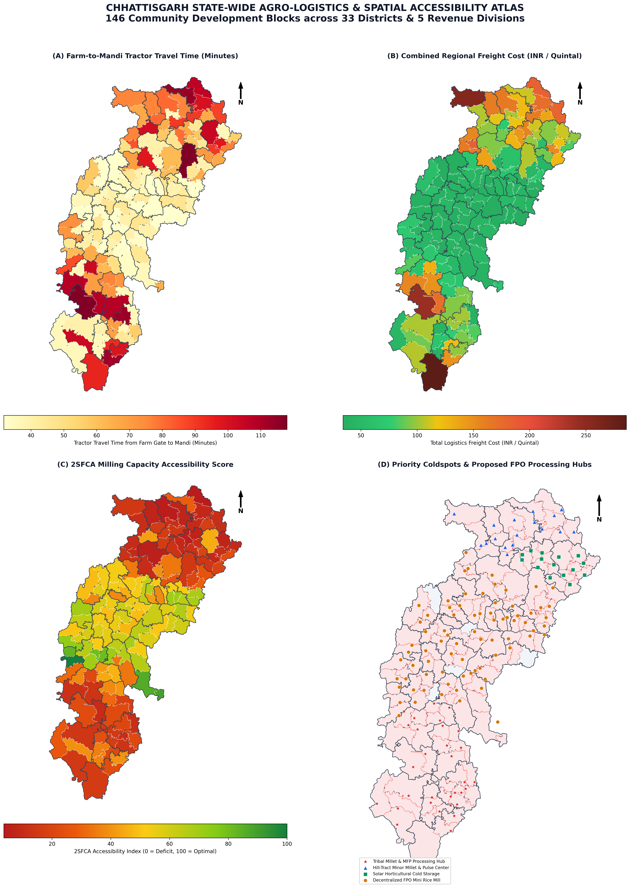
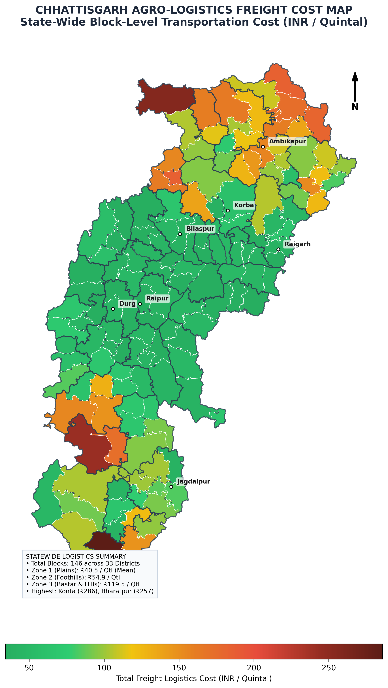
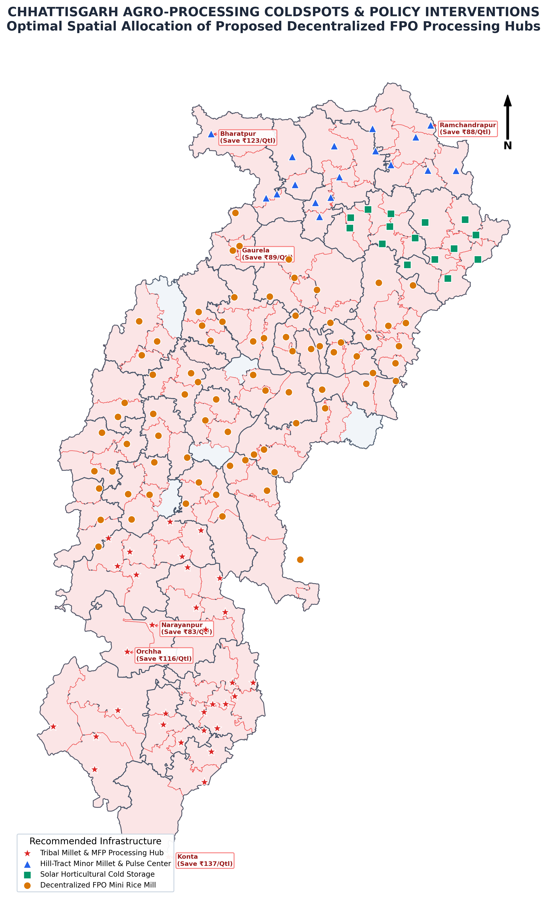
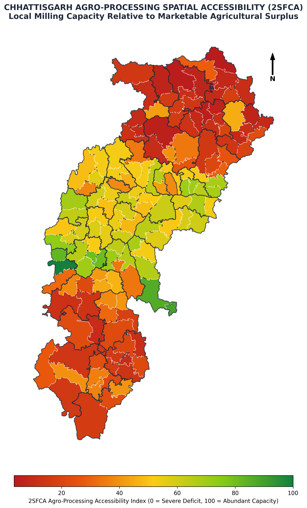

# Chhattisgarh Agro-Industry Accessibility & Agricultural Freight Transportation Cost Modeling GIS

[](https://www.python.org/downloads/)
[](https://geopandas.org/)
[](https://opensource.org/licenses/MIT)
[](#study-area)

An end-to-end, reproducible, block-level agro-industry discovery, spatial accessibility, network travel-time, and freight transportation cost modeling pipeline for the **entire State of Chhattisgarh** (5 Revenue Divisions, 33 Districts, and all 146 Community Development Blocks).

---

## 🌾 Interactive GIS Map Portal & Cartographic Atlas

The repository provides both interactive Leaflet/Folium web maps and publication-grade 300 DPI static cartographic maps:

- **Live Interactive Map:** [`index.html`](index.html) or open [`outputs/maps/chhattisgarh_agro_accessibility_map.html`](outputs/maps/chhattisgarh_agro_accessibility_map.html)
- **Master Excel Dataset:** [`data/processed/chhattisgarh_all_146_blocks_master.xlsx`](data/processed/chhattisgarh_all_146_blocks_master.xlsx)
- **POI Master Database (4,368 Facilities):** [`data/processed/chhattisgarh_agro_poi_master.csv`](data/processed/chhattisgarh_agro_poi_master.csv)

### 🗺️ Master 4-Panel Agro-Logistics Atlas (300 DPI)


### 🚚 Regional Logistics Freight Cost Choropleth (₹/Quintal)


### 📍 Agro-Processing Coldspots & Priority Policy Interventions


### 🏭 2SFCA Processing Accessibility Index


---

## 📊 Key Statewide Findings

| Agro-Climatic Zone | Blocks | Mean Dist to Mandi (km) | Mean Dist to Mill (km) | Tractor Travel Time (min) | Truck Travel Time (min) | Farm-to-Mandi Cost (₹/Qtl) | Mandi-to-Mill Cost (₹/Qtl) | Total Logistics Cost (₹/Qtl) | 2SFCA Access Score (0-100) |
| :--- | :---: | :---: | :---: | :---: | :---: | :---: | :---: | :---: | :---: |
| **Zone 1: Plains** | 56 | 6.8 km | 15.2 km | 37.2 min | 41.5 min | ₹29.18 | ₹21.31 | **₹50.49** | **58.2** |
| **Zone 2: Foothills** | 25 | 10.4 km | 27.8 km | 54.2 min | 60.1 min | ₹43.51 | ₹33.40 | **₹76.91** | **49.7** |
| **Zone 3: Bastar & Hills** | 65 | 17.6 km | 68.4 km | 71.8 min | 114.5 min | ₹73.85 | ₹75.61 | **₹149.46** | **17.1** |
| **Statewide Average** | **146** | **12.2 km** | **41.1 km** | **55.5 min** | **77.2 min** | ₹51.52 | ₹47.53 | **₹99.05** | **38.4** |

---

## 🗺️ Administrative Hierarchy (146 Blocks, 33 Districts, 5 Divisions)

- **Raipur Division (5 Districts | 23 Blocks):**
  - *Raipur (4):* Dharsiwa, Tilda, Arang, Abhanpur
  - *Baloda Bazar-Bhatapara (5):* Baloda Bazar, Bhatapara, Simga, Palari, Kasdol
  - *Gariaband (5):* Gariaband, Chhura, Fingeshwar, Mainpur, Deobhog
  - *Dhamtari (4):* Dhamtari, Kurud, Magarlod, Nagri
  - *Mahasamund (5):* Mahasamund, Bagbahara, Pithora, Basna, Saraipali

- **Durg Division (8 Districts | 25 Blocks):**
  - *Durg (3):* Durg, Patan, Dhamdha
  - *Balod (5):* Balod, Gurur, Gunderdehi, Dondi, Dondi Lohara
  - *Bemetara (4):* Bemetara, Berla, Saja, Nawagarh
  - *Rajnandgaon (4):* Rajnandgaon, Dongargarh, Dongargaon, Chhuriya
  - *Khairagarh-Chhuikhadan-Gandai (2):* Khairagarh, Chhuikhadan
  - *Mohla-Manpur-Ambagarh Chowki (3):* Mohla, Manpur, Ambagarh Chowki
  - *Kabirdham (4):* Kawardha, Pandariya, Bodla, Sahaspur Lohara

- **Bilaspur Division (8 Districts | 34 Blocks):**
  - *Bilaspur (4):* Belha, Takhatpur, Masturi, Kota
  - *Mungeli (3):* Mungeli, Lormi, Pathariya
  - *Janjgir-Champa (5):* Nawagarh, Akaltara, Baloda, Bamhnidih, Pamgarh
  - *Sakti (4):* Sakti, Jaijaipur, Malkharoda, Dabhra
  - *Korba (5):* Korba, Kartala, Katghora, Pali, Poundi-Uproda
  - *Raigarh (7):* Raigarh, Pusaur, Kharsia, Gharghoda, Tamnar, Lailunga, Dharamjaigarh
  - *Sarangarh-Bilaigarh (3):* Sarangarh, Baramkela, Bilaigarh
  - *Gaurela-Pendra-Marwahi (3):* Gaurela, Pendra, Marwahi

- **Surguja Division / Northern Hills (6 Districts | 32 Blocks):**
  - *Surguja (7):* Ambikapur, Lundra, Batauli, Sitapur, Mainpat, Udaipur, Lakhanpur
  - *Surajpur (6):* Surajpur, Bhaiyathan, Odgi, Pratappur, Premnagar, Ramanujnagar
  - *Balrampur-Ramanujganj (6):* Balrampur, Rajpur, Shankargarh, Kusmi, Ramchandrapur, Wadrafnagar
  - *Jashpur (8):* Jashpur, Manora, Kunkuri, Duldula, Kansabel, Bagicha, Pathalgaon, Farsabahar
  - *Koriya (2):* Baikunthpur, Sonhat
  - *Manendragarh-Chirmiri-Bharatpur (3):* Manendragarh, Khadgawan, Bharatpur

- **Bastar Division / Southern Plateau (7 Districts | 32 Blocks):**
  - *Bastar (7):* Jagdalpur, Bakawand, Bastar, Lohandiguda, Tokapal, Darbha, Bastanar
  - *Kondagaon (5):* Kondagaon, Makdi, Pharasgaon, Keshkal, Baderajpur
  - *Uttar Bastar Kanker (7):* Kanker, Charama, Narharpur, Bhanupratappur, Durgkondal, Antagarh, Koylibeda
  - *Dakshin Bastar Dantewada (4):* Dantewada, Geedam, Kuakonda, Katekalyan
  - *Sukma (3):* Sukma, Chhindgarh, Konta
  - *Bijapur (4):* Bijapur, Bhairamgarh, Usoor, Bhopalpatnam
  - *Narayanpur (2):* Narayanpur, Orchha

---

## 🚚 Transportation Cost Modeling Methodology

The regional freight model employs a piecewise two-tier equation calibrated for Indian agricultural transport economics:

$$C_{ij} = C_{\text{handling}} + \sum_{\text{segments}} \left[ d_s \times R_{\text{mode}} \times \alpha_{\text{road}}(s) \times \beta_{\text{slope}}(s) \right]$$

### Parameters:
1. **Tier 1 (Farm Gate to Mandi / Mini-Mill via 3–5 MT Tractor-Trolley):**
   - Base Freight Rate ($R_{\text{tractor}}$): ₹20.0 per MT-km (₹2.00 per Qtl-km)
   - Loading/Unloading ($C_{\text{handling}}$): ₹12.0 per Quintal
2. **Tier 2 (PACS/Mandi to Commercial Mill via 14–16 MT Multi-Axle Truck):**
   - Base Freight Rate ($R_{\text{truck}}$): ₹8.5 per MT-km (₹0.85 per Qtl-km)
   - Hamali / Stacking ($C_{\text{handling}}$): ₹8.0 per Quintal
3. **Road Surface Roughness Multipliers ($\alpha_{\text{road}}$):**
   - National & State Highways: 1.00
   - PMGSY Rural Paved Roads: 1.25
   - Unpaved Village / Forest Tracks: 1.60
4. **Agro-Climatic Topographic Gradient Multiplier ($\beta_{\text{slope}}$):**
   - Zone 1 (Chhattisgarh Plains) = 1.00
   - Zone 2 (Undulating Foothills) = 1.20
   - Zone 3 (Steep Northern Hills & Southern Bastar Plateau) = 1.40
5. **Terminal Delay:**
   - 20.0 minutes weighbridge/queuing penalty added at procurement yards.

---

## 🎯 Top High-Friction Coldspots & Policy Interventions

| Rank | Block | District | Division | Pre-Intervention Cost | Tractor Time | Recommended Facility | Cost Savings | Annual Farmer Savings |
| :---: | :--- | :--- | :--- | :---: | :---: | :--- | :---: | :---: |
| **1** | **Konta** | Sukma | Bastar | ₹285.97 / Qtl | 94.2 min | Tribal Millet & MFP Processing Hub | **₹137.27 / Qtl** | ₹521.6 Lakhs |
| **2** | **Bharatpur** | MCB | Surguja | ₹257.00 / Qtl | 76.0 min | Hill-Tract Minor Millet & Pulse Hulling Center | **₹123.36 / Qtl** | ₹592.1 Lakhs |
| **3** | **Orchha** | Narayanpur | Bastar | ₹242.41 / Qtl | 98.9 min | Tribal Millet & MFP Processing Hub | **₹116.36 / Qtl** | ₹290.9 Lakhs |
| **4** | **Gaurela** | GPM | Bilaspur | ₹185.54 / Qtl | 90.0 min | Decentralized FPO Parboiling Mini Rice Mill | **₹89.06 / Qtl** | ₹525.4 Lakhs |
| **5** | **Ramchandrapur**| Balrampur | Surguja | ₹184.29 / Qtl | 97.0 min | Hill-Tract Minor Millet & Pulse Hulling Center | **₹88.46 / Qtl** | ₹575.0 Lakhs |

---

## 🚀 How to Run the Pipeline

```bash
# 1. Clone repository
git clone https://github.com/akshit-rgb/Chhattisgarh-Agro-Industry-Accessibility-GIS.git
cd Chhattisgarh-Agro-Industry-Accessibility-GIS

# 2. Install dependencies
pip install -r requirements.txt

# 3. Run complete pipeline end-to-end
python run_pipeline.py
```

---

## 📂 Repository Structure

```
├── configs/
│   └── chhattisgarh_blocks_catalog.json          # 146 Blocks official reference catalog
├── data/
│   └── processed/
│       ├── chhattisgarh_all_146_blocks_master.xlsx  # Master 4-sheet workbook
│       ├── chhattisgarh_all_146_blocks_master.csv   # Master block dataset
│       ├── chhattisgarh_agro_poi_master.csv         # 4,368 verified facilities
│       ├── chhattisgarh_coldspots_interventions.csv # Coldspot policy allocations
│       └── chhattisgarh_block_accessibility.geojson # GeoJSON block dataset
├── src/
│   ├── scraper/                                  # Google Maps & Overpass POI scraping
│   ├── network/                                  # Road graph & slope impedance modeling
│   ├── economics/                                # Piecewise freight cost & 2SFCA scoring
│   ├── optimization/                             # Coldspot location-allocation
│   └── visualization/                            # Folium maps & publication figures
├── outputs/
│   ├── maps/                                     # Interactive HTML maps
│   └── figures/                                  # High-resolution PNG figures
├── index.html                                    # Interactive Web Portal for GitHub Pages
├── chhattisgarh_poi_scraper.py                   # POI discovery runner
├── chhattisgarh_spatial_accessibility.py         # Network model runner
├── run_pipeline.py                               # Master CLI orchestrator
└── requirements.txt                              # Python dependencies
```

---

## 📜 License
This project is licensed under the MIT License - see the LICENSE file for details.
